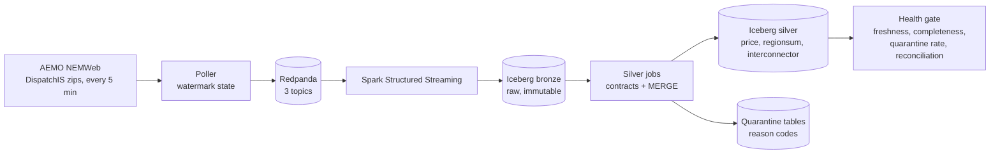

# nem-pulse


A streaming data platform for Australia's National Electricity Market (NEM). It ingests AEMO's live 5-minute dispatch data, lands it in Apache Iceberg tables, enforces data contracts, and checks its own health on every run.

**Status:** Week 1 of 3 complete (live streaming core, silver layer, data contracts, health gate, CI). Backfill, ML and AWS deployment are planned and listed under [Roadmap](#roadmap).

---

## Why this project

The NEM settles every 5 minutes across five regions, and prices can swing from deeply negative to extreme within minutes. That makes it a good place to practise the hard parts of data engineering on real data: late and duplicate records, timezone traps, contracts that must not reject legitimate outliers, and proving a pipeline is trustworthy instead of just claiming it.

## Architecture



| Layer | What it does |
|---|---|
| Poller | Lists NEMWeb, downloads new files, parses AEMO's multi-table CSV, publishes one JSON message per row. State is a single watermark (newest filename published). |
| Redpanda | Kafka-compatible broker. Topics: `nem.dispatch.price`, `nem.dispatch.regionsum`, `nem.dispatch.interconnector`. Message key is `entity\|settlement_time`. |
| Bronze | Raw Kafka payload plus Kafka coordinates, stored untouched in Iceberg. The replayable source of truth. |
| Silver | Parsed and typed. Rows are validated against data contracts, then upserted with `MERGE`. Failures go to a quarantine table with a reason code. |
| Health gate | A script that exits non-zero if the pipeline is stale, incomplete, over its quarantine budget, or physically inconsistent. |

## Results so far

**1. Silver stays exactly-once under replay.**
A restart bug (see [Decisions](#decisions-and-trade-offs)) made the poller republish 79 files. Bronze, which keeps everything, ended with **396 duplicate keys**. Silver, which merges on `(entity, settlement time, intervention)`, ended with **0**.

**2. Data contracts quarantine bad records with reasons.**
A deliberately malformed record (invalid region, absurd price) was routed to `silver.price_quarantine` with reasons `bad_region,rrp_out_of_range`, and never reached the clean table.

**3. A contract of mine was wrong, and the data showed it.**
My first regionsum contract required `TOTALDEMAND >= 0`. It quarantined 21 rows, all from South Australia around midday on a spring Sunday, with demand between -32 and -101 MW. They were real values. I loosened the rule to reject only physically implausible demand (below -5,000 MW or above 40,000 MW), cleared the false quarantines, and replayed regionsum from bronze. Bronze made that fix safe.

**4. SA1 curtailment is visible in the data.**
In those same 12 intervals, with prices between about -$180 and -$415/MWh, SA1's available utility solar was 243-483 MW and cleared **0 MW**. Available wind was 1,838-2,183 MW and cleared 186-295 MW (roughly 10-14%). This establishes that supply was available and undispatched. It does not establish why individual plants didn't dispatch; that needs generator bid data. It also doesn't explain the negative scheduled demand, which I suspect involves rooftop solar, a dataset not yet ingested.

**5. The health gate passes on live data.**
Ten checks across three silver tables: freshness, 5-region and 7-interconnector completeness over a rolling 2-hour window, quarantine rate, and net-interchange reconciliation. In the first live run the worst net-interchange imbalance was 93.8 MW against roughly 17,000 MW of regional demand.

## Decisions and trade-offs

- **Watermark instead of a processed-file list.** My first poller kept the last 500 filenames. NEMWeb retains more than that, so any restart replayed older files. A single watermark (filenames sort chronologically) fixes it. The trade-off: it cannot recover a file AEMO publishes late and out of order. The completeness check is the safety net for that case.
- **At-least-once ingestion, idempotent silver.** The poller may publish a file twice; silver's `MERGE` absorbs it. Bronze keeps the duplicates deliberately.
- **Quarantine instead of drop.** Bad rows are kept with a reason, so a wrong rule can be corrected and the data reprocessed.
- **Contracts reject the impossible, not the unusual.** Negative prices and negative regional demand are real market behaviour. The price contract's upper bound (30,000) is deliberately loose; I have not tied it to AEMO's indexed market price cap.
- **Intervention rows are kept.** AEMO republishes some intervals under intervention (`INTERVENTION = 1`). Silver includes that field in its merge key, so both versions are stored.
- **Health logic is plain Python.** The check functions have no Spark dependency, so CI tests them in seconds without Docker or Kafka.

## Gotchas worth knowing

- **NEM time is fixed UTC+10 with no daylight saving.** Sydney is on UTC+11 in summer, so AEMO timestamps run an hour behind a Sydney wall clock. All timestamps are converted to UTC explicitly.
- **Timestamps are period-ending.** A row stamped `12:25:00` covers 12:20 to 12:25.
- **The market day runs 04:00 to 04:00.** Dispatch interval 001 ends at 04:05, so interval 093 is 11:45 NEM time. Daily aggregations must group by market day, not calendar date.
- **Negative values are normal.** See result 3.

## Known limitations

- Quarantine deduplicates on Kafka coordinates, not business keys, so a replayed bad row appears once per replay.
- The expected interconnector count (7) is hard-coded from observed data and may change.
- The net-interchange tolerance (250 MW) was set from a small sample and should be recalibrated against a longer window.
- Runs locally in Spark `local[2]` mode. Not yet deployed to cloud infrastructure.
- Latency and cost have not been measured yet.

## Run it locally

Requirements: Docker Desktop, Python 3.11+, Java 17.

```bash
git clone https://github.com/Pulkit9918/nem-pulse.git && cd nem-pulse
python3 -m venv .venv && source .venv/bin/activate
pip install -r requirements.txt

docker compose up -d
docker exec redpanda rpk topic create nem.dispatch.price nem.dispatch.regionsum nem.dispatch.interconnector -p 3
```

In separate terminals:

```bash
python -m ingest.poller              # ingest live data
python -m spark_jobs.bronze          # Kafka -> Iceberg bronze
python -m spark_jobs.silver_price    # silver price + quarantine
python -m spark_jobs.silver_other    # silver regionsum + interconnector
python -m quality.health_check       # run the health gate (exit code 0 = healthy)
```

Redpanda Console is mapped to port 8081 in this setup (`http://localhost:8081`).

Tests and lint (what CI runs):

```bash
pip install -r requirements-dev.txt
ruff check .
pytest -q
```

## Repository layout

```
ingest/        poller and AEMO multi-table CSV parser
spark_jobs/    bronze and silver streaming jobs, shared Spark/Iceberg config
quality/       health-check functions (pure Python) and the runner
analysis/      scratch scripts used for investigation
tests/         parser and health-check tests
```

## Roadmap

- [x] Live ingestion into Redpanda
- [x] Iceberg bronze and silver with data contracts, quarantine and idempotent MERGE
- [x] Health gate and CI
- [ ] Historical backfill from AEMO's archive and accelerated replay through the same pipeline
- [ ] Gold layer: region-level features, including a curtailment ratio
- [ ] Weather join (BOM) and a price-spike early-warning model with MLflow and drift monitoring
- [ ] AWS deployment with Terraform (S3, Glue, budget alarms) and a public dashboard
- [ ] Latency and cost report

## Data source

Market data is published by AEMO at [nemweb.com.au](https://nemweb.com.au) under AEMO's Copyright Permissions Notice. This project is not affiliated with or endorsed by AEMO, and the data is used for information only.