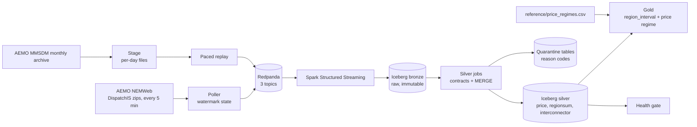

# nem-pulse


A streaming data platform for Australia's National Electricity Market (NEM). It ingests AEMO's live 5-minute dispatch data, lands it in Apache Iceberg tables, enforces data contracts, replays historical months through the same pipeline, and checks its own health on every run.

**Status:** live streaming core, silver layer, data contracts, health gate, CI, a reconciled historical replay (June 2022) and a first gold table are done. Modelling and AWS deployment are planned and listed under [Roadmap](#roadmap).

---

## Why this project

The NEM settles every 5 minutes across five regions, and prices can swing from deeply negative to the market price cap within minutes. That makes it a good place to practise the hard parts of data engineering on real data: late and duplicate records, timezone traps, contracts that must not reject legitimate outliers, market regimes that break statistical assumptions, and proving a pipeline is trustworthy instead of just claiming it.

## Architecture



| Layer | What it does |
|---|---|
| Poller | Lists NEMWeb, downloads new files, parses AEMO's multi-table CSV, publishes one JSON message per row. State is a single watermark (newest filename published). |
| Backfill | Downloads a month from AEMO's MMSDM archive, splits it into per-day files (`stage`), then publishes those days into the same topics at an adjustable speed (`replay`). Replayed messages carry `origin: mmsdm_backfill`. |
| Redpanda | Kafka-compatible broker. Topics: `nem.dispatch.price`, `nem.dispatch.regionsum`, `nem.dispatch.interconnector`. Message key is `entity\|settlement_time`. |
| Bronze | Raw Kafka payload plus Kafka coordinates, stored untouched in Iceberg. The replayable source of truth. |
| Silver | Parsed and typed. Rows are validated against data contracts, then upserted with `MERGE`. Failures go to a quarantine table with a reason code. |
| Gold | `region_interval`: one row per region per 5-minute interval, joining settlement price, regional quantities and a price regime. |
| Health gate | A script that exits non-zero if the pipeline is stale, incomplete, over its quarantine budget, or physically inconsistent. |

## Results so far

**1. Silver stays exactly-once under replay, twice.**
A restart bug (see [Decisions](#decisions-and-trade-offs)) made the poller republish 79 files. Bronze, which keeps everything, ended with 396 duplicate keys. Silver, which merges on `(entity, settlement time, intervention)`, ended with 0. The June 2022 replay then repeated this at scale: one day (13 June) was published twice, leaving exactly 6,480 surplus messages in bronze (2,025 price, 2,025 regionsum, 2,430 interconnector) and still 0 duplicates in silver.

**2. Data contracts quarantine bad records with reasons.**
A deliberately malformed record (invalid region, absurd price) was routed to `silver.price_quarantine` with reasons `bad_region,rrp_out_of_range`, and never reached the clean table.

**3. A contract of mine was wrong, and the data showed it.**
My first regionsum contract required `TOTALDEMAND >= 0`. It quarantined 21 rows, all from South Australia around midday on a spring Sunday, with demand between -32 and -101 MW. They were real values. I loosened the rule to reject only physically implausible demand (below -5,000 MW or above 40,000 MW), cleared the false quarantines, and replayed regionsum from bronze. Keeping bronze made that fix safe.

**4. SA1 curtailment is visible in the data.**
In those same 12 intervals, with prices between about -$180 and -$415/MWh, SA1's available utility solar was 243-483 MW and cleared 0 MW. Available wind was 1,838-2,183 MW and cleared 186-295 MW (roughly 10-14%). This establishes that supply was available and undispatched. It does not establish why individual plants didn't dispatch; that needs generator bid data. It also doesn't explain the negative scheduled demand, which I suspect involves rooftop solar, a dataset not yet ingested.

**5. The health gate passes on live data, and the backfill exposed a flaw in it.**
Ten checks across three silver tables: freshness, 5-region and 7-interconnector completeness over a rolling 2-hour window, quarantine rate, and net-interchange reconciliation (worst imbalance seen: 93.8 MW against roughly 17,000 MW of regional demand). After the backfill, the quarantine rate for prices dropped from 0.10% to 0.01% without any change in data quality, because 56,000 replayed rows counted as "ingested in the last 24 hours". The check now measures live traffic only.

**6. The historical replay reconciles exactly.**
June 2022 (8,640 intervals, 30 days) was staged, published and processed through the same bronze and silver jobs as live data:

| Table | Staged | Published | Bronze (unique) | Silver | Silver duplicates | Quarantined |
|---|---|---|---|---|---|---|
| price | 56,560 | 56,560 | 56,560 | 56,560 | 0 | 0 |
| regionsum | 56,560 | 56,560 | 56,560 | 56,560 | 0 | 0 |
| interconnector | 67,872 | 67,872 | 67,872 | 67,872 | 0 | 0 |

None of the 180,992 messages was rejected by the live contracts, even though the month includes prices from -$615 to the $15,100 cap and AEMO's market suspension.

**7. `INTERVENTION=0` is the settlement price.**
When AEMO reruns an interval under intervention, both runs are published. AEMO's data model calls the field only a "manual intervention flag". I tested it against `TRADINGPRICE`: `INTERVENTION=0` matched in all 43,200 rows, while `INTERVENTION=1` differed from the settlement price in 5,371 of the 13,360 intervals where both runs were published.

**8. The June 2022 market suspension, reconstructed from data and AEMO's notices.**
The suspension dates are not in the `MARKETSUSPENSION` table. They come from AEMO's market notices (decoded from base64 in the archive) and the price data agreed with them to the interval:

| Window (NEM time) | Pricing regime | Evidence in the data |
|---|---|---|
| 15 Jun 14:05 to 23 Jun 04:00 | Market suspension schedule pricing | All 2,184 intervals have intervention rows; daily maximum price is exactly $300 on 16-22 June |
| 23 Jun 04:05 to 24 Jun 14:00 | Suspended, dispatch pricing | `MARKETSUSPENDEDFLAG` set in exactly 408 intervals in every region, matching the notices |
| Per region, from `APEVENT` | Administered pricing | 10,737 region-intervals inside administered windows, none outside -$300 to $300 |

Intervention rows begin on 13 June, before the suspension was declared (488 of the 2,672 intervention intervals fall outside the schedule-pricing window). TAS1 has no administered-pricing events in this month. AEMO also reports zero FCAS prices from 04:00 on 23 June, so FCAS data for that morning is unreliable.

**9. Gold v1: regime-aware regional table.**
`gold.region_interval` holds 43,200 June 2022 rows with no duplicate keys, grouped by NEM market day (the 04:00 to 04:00 day). Prices by regime:

| Regime | Rows | Min | Mean | Max |
|---|---|---|---|---|
| market | 27,951 | -615.3 | 390.5 | 15,100.0 |
| administered | 2,289 | -300.0 | 241.4 | 300.0 |
| suspended_dispatch | 2,040 | -95.0 | 221.6 | 1,260.0 |
| suspended_schedule | 10,920 | 58.3 | 240.9 | 300.0 |

Regimes can overlap (AEMO's notice says administered pricing continued during the suspension but had no practical effect). The rule is suspension over administered over market. The point of the column is to keep administered and formula-driven prices out of any spike-model training and evaluation.

## Decisions and trade-offs

- **Watermark instead of a processed-file list.** My first poller kept the last 500 filenames. NEMWeb retains more than that, so any restart replayed older files. A single watermark (filenames sort chronologically) fixes it. The trade-off: it cannot recover a file AEMO publishes late and out of order. The completeness check is the safety net for that case.
- **At-least-once ingestion, idempotent silver.** The poller may publish a file twice; silver's `MERGE` absorbs it. Bronze keeps the duplicates deliberately.
- **Quarantine instead of drop.** Bad rows are kept with a reason, so a wrong rule can be corrected and the data reprocessed.
- **Contracts reject the impossible, not the unusual.** Negative prices and negative regional demand are real market behaviour. The price contract's upper bound (30,000) is deliberately loose.
- **Intervention rows are kept in silver.** Silver's merge key includes the intervention flag, so both runs are stored.
- **History goes through the production pipeline.** Rather than loading history with a separate batch script, I stage it as files and replay it through the same Kafka topics, bronze and silver jobs. That exercises the contracts and the idempotency on real, unusual data. The cost is speed: a month takes about 29 minutes at the default replay rate on a laptop. Replay is paced so a Spark micro-batch never receives an unbounded burst.
- **Staging is restartable.** Each monthly archive is split into per-day files, so replay can resume at any interval without holding a month in memory.
- **Gold uses the settlement run (`INTERVENTION=0`) for price and for quantities.** The price choice is verified (result 7). Using the same run for quantities is a consistency choice that I have not verified against the physical run.
- **Health logic is plain Python.** The check functions have no Spark dependency, so CI tests them in seconds without Docker or Kafka.

## Gotchas worth knowing

- **NEM time is fixed UTC+10 with no daylight saving.** Sydney is on UTC+11 in summer, so AEMO timestamps run an hour behind a Sydney wall clock. All timestamps are converted to UTC explicitly.
- **Timestamps are period-ending.** A row stamped `12:25:00` covers 12:20 to 12:25.
- **The market day runs 04:00 to 04:00.** Dispatch interval 001 ends at 04:05, so interval 093 is 11:45 NEM time, and 00:05 on 1 June belongs to interval 241 of 31 May. Daily aggregations must group by market day, not calendar date.
- **AEMO's two archives cover different spans.** The `DispatchIS` archive holds only about a year of daily files. Older history is in the monthly MMSDM archive, whose files have the same multi-table CSV layout but different table versions and column sets (for example, 54 price columns in 2022 against more in current files).
- **A column being present is not the same as being populated.** In June 2022 the regionsum table contains the solar and wind availability, battery and reserve-surplus columns, but they are 0% populated.
- **Negative values are normal.** See result 3.

## Known limitations

- Only June 2022 has been backfilled. The price regime reference file is hand-built from that month's notices and administered-pricing events; other months would need their own, and the process is not yet automated.
- `curtailment_ratio` can only be computed where availability columns are populated, so it is null for all of 2022 and defined for live data only (live range so far 0.0 to 0.967).
- Gold v1 has no interconnector, rooftop solar or weather features yet.
- Quarantine deduplicates on Kafka coordinates, not business keys, so a replayed bad row appears once per replay.
- The expected interconnector count (7) is a live-data assumption. June 2022 has 6, since `NSW1-SA1` did not exist then.
- The net-interchange tolerance (250 MW) was set from a small sample and should be recalibrated against a longer window.
- Whether `INTERVENTION=0` is the right run for physical quantities is unverified.
- Runs locally in Spark `local[2]` mode. Not yet deployed to cloud infrastructure.
- Latency and cost have not been measured yet.

## Run it locally

Requirements: Docker Desktop, Python 3.11+, Java 17.

```bash
git clone https://github.com/Pulkit9918/nem-pulse.git && cd nem-pulse
python3 -m venv .venv && source .venv/bin/activate
pip install -r requirements.txt

docker compose up -d
docker exec redpanda rpk topic create nem.dispatch.price nem.dispatch.regionsum nem.dispatch.interconnector -p 3
```

In separate terminals:

```bash
python -m ingest.poller              # ingest live data
python -m spark_jobs.bronze          # Kafka -> Iceberg bronze
python -m spark_jobs.silver_price    # silver price + quarantine
python -m spark_jobs.silver_other    # silver regionsum + interconnector
python -m quality.health_check       # run the health gate (exit code 0 = healthy)
```

Replay a historical month (the stream jobs above must be running):

```bash
python -m backfill.stage 2022 6                                   # download + split into per-day files
python -m backfill.replay --start 2022-06-13 --end 2022-06-13 --dry-run
python -m backfill.replay --start 2022-06-01 --end 2022-06-30 --speed 1500
python -m backfill.regimes                                        # rebuild reference/price_regimes.csv and validate it
python -m spark_jobs.gold_region_interval                         # build the gold table
```

Redpanda Console is mapped to port 8081 in this setup (`http://localhost:8081`).

Tests and lint (what CI runs):

```bash
pip install -r requirements-dev.txt
ruff check .
pytest -q
```

## Repository layout

```
ingest/        poller and AEMO multi-table CSV parser
spark_jobs/    bronze, silver and gold streaming/batch jobs, shared Spark/Iceberg config
backfill/      MMSDM download, staging, paced replay, regime reconstruction
reference/     price_regimes.csv (built by backfill.regimes)
quality/       health-check functions (pure Python) and the runner
analysis/      scratch and reconciliation scripts
tests/         parser and health-check tests
```

## Roadmap

- [x] Live ingestion into Redpanda
- [x] Iceberg bronze and silver with data contracts, quarantine and idempotent MERGE
- [x] Health gate and CI
- [x] Historical replay through the production pipeline (June 2022), reconciled
- [x] Gold v1: region intervals with price regime
- [ ] Choose a training window: find which months have populated availability, battery and reserve columns
- [ ] Gold v2: interconnector features, rooftop solar (30-minute data with satellite and measurement rows), weather join (BOM)
- [ ] Price-spike early-warning model with MLflow and drift monitoring, evaluated with regime awareness
- [ ] AWS deployment with Terraform (S3, Glue, budget alarms) and a public dashboard
- [ ] Latency and cost report

## Data source

Market data is published by AEMO at [nemweb.com.au](https://nemweb.com.au) under AEMO's Copyright Permissions Notice. This project is not affiliated with or endorsed by AEMO, and the data is used for information only.